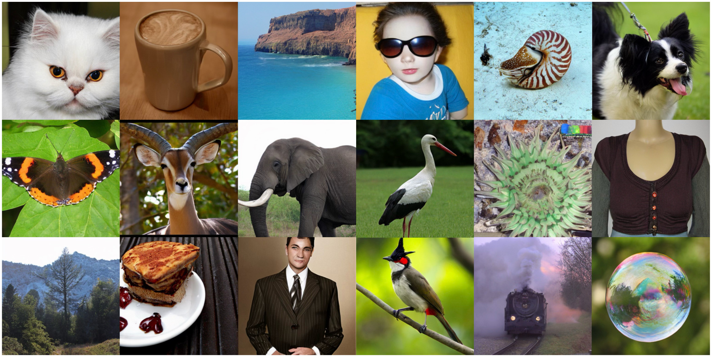
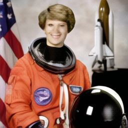
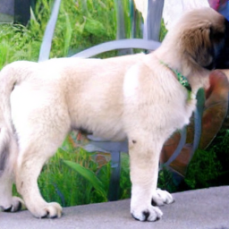
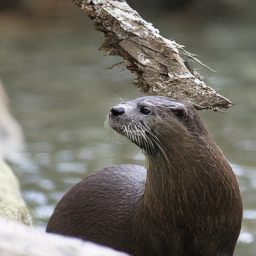
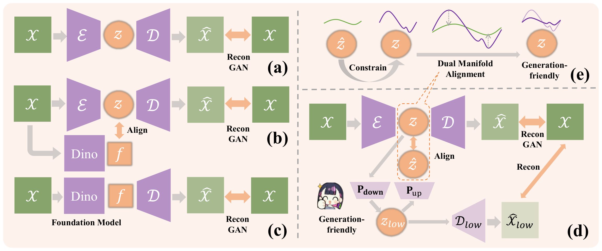

<div align="center">

# Dual-Manifold Variational Autoencoders

**Hongxu Chen\*** · **Chun Wang\*** · Yanghao Wang · Hongxiang Li · Zhen Wang · Zhixiang Zhang · Long Chen†<br>
The Hong Kong University of Science and Technology<br>
<sub>* Equal contribution · † Corresponding author</sub>

[Project page](https://ustcchx.github.io/DM-VAE-page/) · [Checkpoints](https://huggingface.co/Davidwang215/dmvae) · [Quick start](#quick-start) · [Training](#training) · [Citation](#citation)

</div>



*ImageNet-256 samples from the f16d32 model at 64 epochs, using internal skeleton guidance without classifier-free guidance. Gallery from the paper.*

## Quick start

First, install [PyTorch](https://pytorch.org/get-started/locally/) for your GPU, then set up the environment:

```bash
python -m venv .venv
source .venv/bin/activate
python -m pip install -e ".[hub]"
```

Weights are public at [Davidwang215/dmvae](https://huggingface.co/Davidwang215/dmvae); no access request or login is needed. The `dmvae.download` commands below fetch them, verify their SHA-256, and save them to `weights/`.

### Reconstruct an image

```bash
python -m dmvae.download f16d32
python -m dmvae.reconstruct --checkpoint weights/dmvae-f16d32.safetensors \
  --input assets/astronaut.jpg --output outputs/reconstruction
```

Saves the cropped 256 × 256 input (`input.png`), full reconstruction (`high.png`), and 16-channel reconstruction (`low.png`):

| Input | Full latent (32 channels) | Skeleton (16 channels) |
| :---: | :---: | :---: |
|  |  |  |

### Generate images

```bash
python -m dmvae.download f16d32 dit-d32-400
python -m generation.sample \
  --vae weights/dmvae-f16d32.safetensors --dit weights/dit-f16d32-400ep.safetensors \
  --recipe 400ep-ig-cfg --classes 207 360 --count 2 --output outputs/samples
```

Generates samples for ImageNet classes 207 and 360. The `400ep-ig-cfg` recipe combines internal guidance with CFG (adding an unconditional pass during its active interval); use `400ep-ig` for single-pass internal guidance without CFG. Output:

<p>


</p>

See [sampling recipes and normalization](generation/README.md) and [FID-50K / reconstruction evaluation](evaluation/README.md) for details.

## Training

Training and feature extraction require Linux, macOS, or WSL2 (due to POSIX file locks). Published ImageNet runs used Linux with CUDA.

```bash
python -m pip install -e ".[train]"
```

- [Train DM-VAEs](training/vae/README.md) from an ImageFolder training split.
- [Train the generator](training/dit/README.md) based on f16d32 or f16d64 DM-VAEs.

## Checkpoints

DM-VAE downsamples each spatial dimension by 16 (256 × 256 → 16 × 16). Model names indicate the **full** latent width, and each generator pairs with its matching tokenizer, channel statistics, and TRA head.

All weights are public on Hugging Face: **[Davidwang215/dmvae](https://huggingface.co/Davidwang215/dmvae)** (safetensors, no access request needed).

| DiT-XL | Full / skeleton channels | DM-VAE | LightningDiT-XL | `dmvae.download` names |
| --- | ---: | --- | --- | --- |
| f16d32 · 64 epochs | 32 / 16 | [dmvae-f16d32-50ep](https://huggingface.co/Davidwang215/dmvae/blob/main/vae/dmvae-f16d32-50ep.safetensors) | [lightningdit-f16d32-64ep](https://huggingface.co/Davidwang215/dmvae/blob/main/lightningdit/lightningdit-f16d32-64ep.safetensors) | `dit-d32-64 f16d32` |
| f16d32 · 400 epochs | 32 / 16 | [dmvae-f16d32-50ep](https://huggingface.co/Davidwang215/dmvae/blob/main/vae/dmvae-f16d32-50ep.safetensors) | [lightningdit-f16d32-400ep](https://huggingface.co/Davidwang215/dmvae/blob/main/lightningdit/lightningdit-f16d32-400ep.safetensors) | `dit-d32-400 f16d32` |
| f16d64 · 400 epochs | 64 / 32 | [dmvae-f16d64-50ep](https://huggingface.co/Davidwang215/dmvae/blob/main/vae/dmvae-f16d64-50ep.safetensors) | [lightningdit-f16d64-400ep](https://huggingface.co/Davidwang215/dmvae/blob/main/lightningdit/lightningdit-f16d64-400ep.safetensors) | `dit-d64-400 f16d64` |

Both f16d32 generators share the same tokenizer. To download all three generators and both tokenizers:

```bash
python -m dmvae.download dit-d32-64 dit-d32-400 dit-d64-400 f16d32 f16d64
```

Local filenames, the pinned revision, and SHA-256 digests are listed in the [checkpoint catalog](dmvae/weights.json).

## Method



1. **Dual-manifold tokenizer** — [dmvae/autoencoder.py](dmvae/autoencoder.py)
2. **Topological representation alignment (TRA)** — [training/dit/objective.py](training/dit/objective.py)
3. **Internal guidance with topological skeleton (IG<sub>TS</sub>)** — [generation/sampling.py](generation/sampling.py)

## Reported results

**Reconstruction.** Evaluated on the ImageNet-1K validation set and zero-shot on Anime-Faces-256 (lower rFID and higher PSNR are better).

| Tokenizer | ImageNet rFID ↓ | ImageNet PSNR ↑ | Anime-Faces rFID ↓ | Anime-Faces PSNR ↑ |
| --- | ---: | ---: | ---: | ---: |
| DM-VAE f16d32 | 0.21 | 28.50 | 1.93 | 30.30 |
| DM-VAE f16d64 | **0.12** | **30.76** | **1.12** | **32.87** |

**Class-conditional ImageNet-256 generation.** FID over 50,000 samples (lower is better).

| DiT-XL tokenizer | Epochs | IG<sub>TS</sub> ↓ | IG<sub>TS</sub> + CFG ↓ |
| --- | ---: | ---: | ---: |
| DM-VAE + DINOv2, f16d32 | 400 | 1.29 | 1.11 |
| DM-VAE f16d32 | 64 | 2.62 | 1.67 |
| DM-VAE f16d32 | 400 | **1.25** | **1.17** |
| DM-VAE f16d64 | 400 | 1.28 | 1.20 |

## Citation

```bibtex
@article{chen2026dmvae,
  title   = {Dual-Manifold Variational Autoencoders},
  author  = {Chen, Hongxu and Wang, Chun and Wang, Yanghao and Li, Hongxiang and Wang, Zhen and Zhang, Zhixiang and Chen, Long},
  journal = {arXiv preprint},
  year    = {2026}
}
```

Built on the convolutional autoencoder designs of [CompVis](https://github.com/CompVis/latent-diffusion) and the [LightningDiT / VA-VAE](https://github.com/hustvl/LightningDiT) generator. See [third-party acknowledgments](third_party/README.md) for code and image credits.