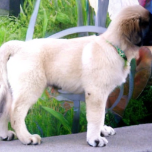

# Class-conditional generation

The f16d32 and f16d64 generators pair 32- and 64-channel DM-VAE image latents with 16- and 32-channel topological skeletons, respectively. A LightningDiT-XL/1 predicts flow velocity on a 16 × 16 token grid. Its TRA projection reads the output of the eighth transformer block and predicts a direction in the skeleton space. [Model](model.py) · [Euler solver](sampling.py) · [DiT training](../training/dit/README.md)

## Weights

Weights are public at [Davidwang215/dmvae](https://huggingface.co/Davidwang215/dmvae). From the repository root, download the f16d32 tokenizer and the 400-epoch generator.

```bash
python -m dmvae.download f16d32 dit-d32-400
```

Use `dit-d32-64` to download the 64-epoch generator. Checkpoint selection and file hashes are listed below.

| Model | Selection | SHA-256 |
| --- | --- | --- |
| `f16d32` | EMA | `03f037b19412efb8406034a45a72fd9e7a70dcbb4f0de19c0a9fab67cc64a722` |
| `dit-d32-64` | EMA 0.9995 | `7c9c925c4d7980524092ec4593a4a7ecde7fab5e3422801651fa5b616dac28d3` |
| `dit-d32-400` | EMA 0.9999 | `fd109b8e44feb12e4b5132e935f86922d232e661ba27d51355f13d9a89e1116c` |

## Generate images

```bash
python -m generation.sample \
  --dit weights/dit-f16d32-400ep.safetensors --vae weights/dmvae-f16d32.safetensors \
  --recipe 400ep-ig-cfg --classes 207 360 --count 2 --output samples
```

This writes two 256 × 256 PNGs. The sample ID determines the seed and filename. Without `--classes`, the label is the sample ID modulo 1,000. Use `--start-index` to generate another range or `--batch-size 1` to reduce memory use. Pass `--help` to see all options.

## ImageNet-256 recipes

| CLI recipe | EMA | IG_TS scale & active interval | CFG scale & active interval | Reported FID-50K ↓ |
| --- | --- | --- | --- | ---: |
| `64ep-ig` | 64 epochs | 2.6 · [0, 0.30) | Off | 2.62 |
| `64ep-ig-cfg` | 64 epochs | 1.5 · [0, 0.30) | 2.65 · [0.30, 0.70) | 1.67 |
| `400ep-ig` | 400 epochs | 1.9 · [0, 0.55) | Off | 1.25 |
| `400ep-ig-cfg` | 400 epochs | 1.5 · [0, 0.55) | 1.3 · [0.15, 1) | 1.17 |

These are the f16d32 results without an external vision encoder. The matching evaluation uses class-balanced ImageNet labels, one CUDA noise generator per image seeded with `1234 + sample_id`, 250 uniform Euler steps from noise to data, bfloat16 inference and float32 trajectory accumulation. The `unguided` recipe runs the underlying flow without either guidance term. [Project results](https://ustcchx.github.io/DM-VAE-page/)

### f16d64 tokenizer

The f16d64 generator uses the f16d64 tokenizer, its own latent statistics, and a timestep-normalized LightningDiT-XL. Use the 400-epoch generator (EMA 0.9997). The `d64-400ep-ig` recipe uses IG_TS 1.9 over [0, 0.60) and has reported FID-50K 1.28. The `d64-400ep-ig-cfg` recipe uses IG_TS 1.5 over [0, 0.60) and CFG 1.35 over [0.15, 1), with reported FID-50K 1.20. [Statistics](configs/f16d64.json)

```bash
python -m dmvae.download f16d64 dit-d64-400
python -m generation.sample \
  --dit weights/dit-f16d64-400ep.safetensors --vae weights/dmvae-f16d64.safetensors \
  --recipe d64-400ep-ig-cfg --classes 207 --count 1 --output samples-d64
```

### DINOv2-aligned tokenizer

The paper also evaluates a 32-channel tokenizer with a 12-channel skeleton and DINOv2 alignment during VAE training. The paper reports this variant in its 400-epoch comparison. The `dino-400ep-ig` recipe uses IG_TS 1.8 over [0.05, 0.80) and yields a reported FID-50K of 1.29. The `dino-400ep-ig-cfg` recipe uses IG_TS 1.4 over [0.05, 0.95) and CFG 1.35 over [0.15, 1), with reported FID-50K 1.11. Each recipe selects the corresponding channel statistics automatically. [Statistics](configs/f16d32-dino.json)

To sample with a local copy of the DINOv2-aligned weights, pass the two checkpoint paths.

```bash
python -m generation.sample \
  --dit /path/to/dino-dit.pt --vae /path/to/dino-vae.pt \
  --recipe dino-400ep-ig-cfg --classes 360 --start-index 1 --count 1 --output samples-dino
```

### Generation examples

These examples were generated with the commands in this guide on an H100 using BF16, 250 Euler steps and the 400-epoch IG_TS + CFG recipe for each model. The sample index and seed match within each row.

| ImageNet class · seed | f16d32 | Paired example |
| --- | :---: | :---: |
| Golden retriever (207) · 1234 |  | **f16d64**<br> |
| Otter (360) · 1235 |  | **f16d32 + DINOv2**<br> |

### How the sampler works

**Latent coordinates.** The input to the DiT is `(z - mean) * scale`, with one mean and one reciprocal standard deviation per high-dimensional channel. The shipped statistics come from a fixed 10,000-image subset of the original ImageNet training images, using unflipped posterior samples. Decoding uses the inverse transform. The sampler checks that the supplied VAE matches the SHA-256 in the statistics file. [f16d32 statistics](configs/f16d32.json)

**Guidance.** During the active IG_TS interval, the conditional DiT call supplies both the final velocity and the intermediate TRA prediction. In raw VAE coordinates, the sampler adjusts the lifted skeleton and restores the residual details. During the CFG interval it performs one additional unconditional DiT evaluation and extrapolates toward the guided conditional velocity. [Implementation](sampling.py)

The generator follows LightningDiT and preserves the original state-dict names for the backbone and the TRA head. [LightningDiT](https://github.com/hustvl/LightningDiT) · [Upstream license](../third_party/LightningDiT-LICENSE)
